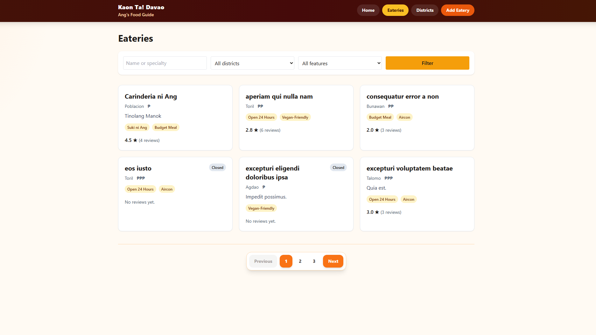
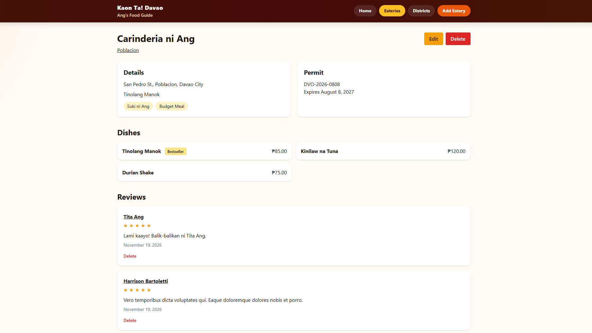
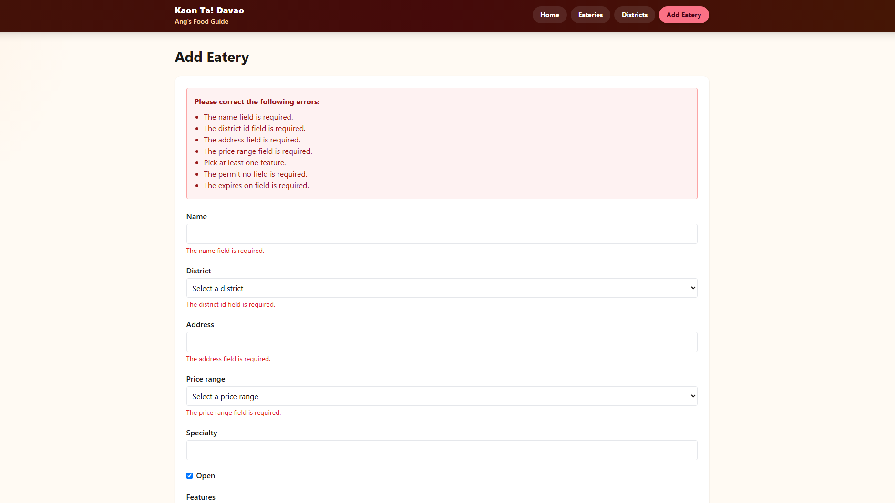

# Kaon Ta! Davao - Ang's Food Guide

**Full name:** Megan Ang

A Laravel 12 guide for Davao City carinderias and eateries, featuring districts, permits, dishes, features, and resident reviews.

## Setup

Run the following commands from the project root:

```bash
composer install
cp .env.example .env
php artisan key:generate
touch database/database.sqlite
php artisan migrate:fresh --seed
npm install
npm run build
php artisan serve
```

## Personalized Data

### Districts

- Poblacion
- Talomo
- Agdao
- Buhangin
- Toril
- Bunawan

### Features

- Suki ni Ang
- Budget Meal
- Halal
- Open 24 Hours
- Aircon
- Vegan-Friendly

### Seeded Users

| Name      | Email                | Password   |
| --------- | -------------------- | ---------- |
| Megan Ang | ang@kaonta.test      | kaonta2026 |
| Tita Ang  | tita.ang@kaonta.test | kaonta2026 |

### Hand-made Eatery

- Name: Carinderia ni Ang
- Slug: `carinderia-ni-ang`
- District: Poblacion
- Address: San Pedro St., Poblacion, Davao City
- Price range: Budget
- Specialty: Tinolang Manok
- Features: Suki ni Ang and Budget Meal
- Permit: DVO-2026-0808
- Permit expiry: August 8, 2027 (`2027-08-08`)

### Hand-made Eatery Dishes

| Dish            |   Price | Bestseller |
| --------------- | ------: | ---------- |
| Tinolang Manok  |  ₱85.00 | Yes        |
| Kinilaw na Tuna | ₱120.00 | No         |
| Durian Shake    |  ₱75.00 | No         |

## Eloquent Relationships

| Relationship                      | Type                              | Why it fits                                                                                                              |
| --------------------------------- | --------------------------------- | ------------------------------------------------------------------------------------------------------------------------ |
| District -> Eatery                | `hasMany` / `belongsTo`           | One district can contain many eateries, and each eatery belongs to exactly one district.                                 |
| Eatery -> Dish                    | `hasMany` / `belongsTo`           | An eatery offers many dishes, while each dish belongs to one eatery.                                                     |
| Eatery -> Review                  | `hasMany` / `belongsTo`           | A resident may contribute several reviews to an eatery, and every review belongs to one eatery.                          |
| User -> Review                    | `hasMany` / `belongsTo`           | A reviewer can write many reviews, but each review has one selected reviewer.                                            |
| Eatery -> Permit                  | `hasOne` / `belongsTo`            | Each eatery has one business permit, and the permit belongs to that eatery.                                              |
| Eatery <-> Feature                | `belongsToMany` / `belongsToMany` | An eatery can have many features, and a feature can apply to many eateries through `eatery_feature`.                     |
| District -> Review through Eatery | `hasManyThrough`                  | District pages can count reviews belonging to eateries in the district without directly storing district IDs on reviews. |

## Routes

```text
GET|HEAD / .. home › HomeController
 GET|HEAD districts .. districts.index › DistrictController@index
 GET|HEAD districts/{district} .. districts.show › DistrictController@show
 GET|HEAD eateries .. eateries.index › EateryController@index
 POST eateries .. eateries.store › EateryController@store
 GET|HEAD eateries/create .. eateries.create › EateryController@create
 GET|HEAD eateries/{eatery} .. eateries.show › EateryController@show
 PUT|PATCH eateries/{eatery} .. eateries.update › EateryController@update
 DELETE eateries/{eatery} .. eateries.destroy › EateryController@destroy
 GET|HEAD eateries/{eatery}/edit .. eateries.edit › EateryController@edit
 POST eateries/{eatery}/reviews .. eateries.reviews.store › ReviewController@store
 GET|HEAD reviewers/{user} .. reviewers.show › ReviewerController@show
 DELETE reviews/{review} .. reviews.destroy › ReviewController@destroy

 Showing [13] routes
```

## Screenshots

### Eatery List



### Eatery Page with Reviews



### Create Eatery Validation Errors


